# Hi there 👋

### I'm Norton_Lin
- 🏫 A master's student at Beijing University of Posts and Telecommunications.
- 🌱 Majoring in Moving Target Defense and Zero Trust Architecture
- 💻 Skilled in backend development
- 🤖 Currently interested in the field of intelligent agents
- 📫 How to reach me: [norton@bupt.edu.cn](mailto:norton@bupt.edu.cn)

- Welcome to communicate with me

### Some Stats





<!--START_SECTION:waka-->


**🐱 My GitHub Data** 

> 📦 619.6 kB Used in GitHub's Storage 
 > 
> 🏆 15 Contributions in the Year 2026
 > 
> 🚫 Not Opted to Hire
 > 
> 📜 23 Public Repositories 
 > 
> 🔑 13 Private Repositories 
 > 
**I'm an Early 🐤** 

```text
🌞 Morning                519 commits         ████░░░░░░░░░░░░░░░░░░░░░   17.40 % 
🌆 Daytime                1290 commits        ███████████░░░░░░░░░░░░░░   43.26 % 
🌃 Evening                988 commits         ████████░░░░░░░░░░░░░░░░░   33.13 % 
🌙 Night                  185 commits         ██░░░░░░░░░░░░░░░░░░░░░░░   06.20 % 
```
📅 **I'm Most Productive on Tuesday** 

```text
Monday                   356 commits         ███░░░░░░░░░░░░░░░░░░░░░░   11.94 % 
Tuesday                  545 commits         █████░░░░░░░░░░░░░░░░░░░░   18.28 % 
Wednesday                468 commits         ████░░░░░░░░░░░░░░░░░░░░░   15.69 % 
Thursday                 527 commits         ████░░░░░░░░░░░░░░░░░░░░░   17.67 % 
Friday                   359 commits         ███░░░░░░░░░░░░░░░░░░░░░░   12.04 % 
Saturday                 298 commits         ██░░░░░░░░░░░░░░░░░░░░░░░   09.99 % 
Sunday                   429 commits         ████░░░░░░░░░░░░░░░░░░░░░   14.39 % 
```


📊 **This Week I Spent My Time On** 

```text
🕑︎ Time Zone: Asia/Shanghai

💬 Programming Languages: 
Python                   21 hrs 43 mins      ███████████████░░░░░░░░░░   59.58 % 
Markdown                 8 hrs 40 mins       ██████░░░░░░░░░░░░░░░░░░░   23.79 % 
JSON                     2 hrs               █░░░░░░░░░░░░░░░░░░░░░░░░   05.52 % 
Text                     1 hr 38 mins        █░░░░░░░░░░░░░░░░░░░░░░░░   04.48 % 
Go                       1 hr 16 mins        █░░░░░░░░░░░░░░░░░░░░░░░░   03.48 % 

🔥 Editors: 
Codex Vscode             31 hrs 45 mins      ██████████████████████░░░   87.13 % 
VS Code                  4 hrs 41 mins       ███░░░░░░░░░░░░░░░░░░░░░░   12.87 % 

🐱‍💻 Projects: 
zta-base-dual-pep        31 hrs 30 mins      ██████████████████████░░░   86.41 % 
论文集                      4 hrs 54 mins       ███░░░░░░░░░░░░░░░░░░░░░░   13.46 % 
Unknown Project          2 mins              ░░░░░░░░░░░░░░░░░░░░░░░░░   00.13 % 

💻 Operating System: 
Windows                  36 hrs 27 mins      █████████████████████████   100.00 % 
```

🤖 **AI Coding This Week** 

```text
⏱ AI Coding Time: 35 hrs 29 mins (97.33%)

✍️ 205,131 lines written by AI, 8 lines written by hand (100.0% AI-written)

🔤 40,152,333 Input Tokens, 11,936,950 Output Tokens

💵 $3752.74 Estimated AI Cost This Week

🧠 107 AI Sessions, 133 AI Prompts

GPT                      205,117 lines       █████████████████████████   99.90 % 
Codex-Vscode             199 lines           ░░░░░░░░░░░░░░░░░░░░░░░░░   00.10 % 

🔎 AI Coding Insights:
🤖 AI-Driven — 100.0% of written lines came from AI
📝 Concise Prompter — average 225 characters per prompt
🎯 One-Shot Prompter — average 1 prompts per session
🚀 High AI Trust — 0.01% of changed lines were hand-edited
```

**I Mostly Code in Python** 

```text
Python                   7 repos             ███████░░░░░░░░░░░░░░░░░░   28.00 % 
Go                       4 repos             ████░░░░░░░░░░░░░░░░░░░░░   16.00 % 
Kotlin                   1 repo              █░░░░░░░░░░░░░░░░░░░░░░░░   04.00 % 
HTML                     1 repo              █░░░░░░░░░░░░░░░░░░░░░░░░   04.00 % 
JavaScript               1 repo              █░░░░░░░░░░░░░░░░░░░░░░░░   04.00 % 
```


**Timeline**


 Last Updated on 26/10/2026 22:51:09 UTC
<!--END_SECTION:waka-->
